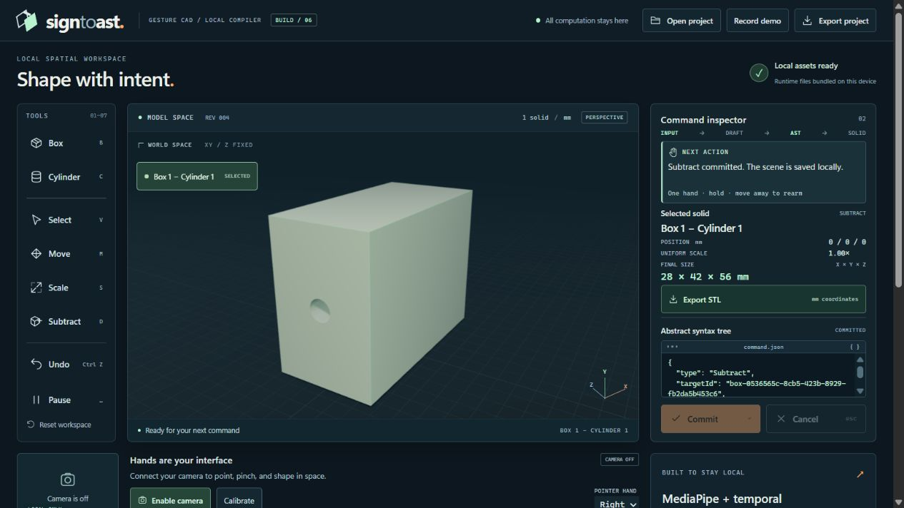

# SignToAST

**Local gesture CAD with a typed command compiler and exportable solid geometry.**

SignToAST turns webcam hand input into editable CAD operations. Users create solids, adjust their dimensions and position, preview changes, and explicitly commit each operation. MediaPipe hand landmarks and temporal gesture rules drive the interface. A typed Abstract Syntax Tree (AST) connects those interactions to real Manifold Boolean geometry.

## Features

- **Two-hand gesture control:** a mirrored cursor, stable button targeting, pinch selection, XY dragging, and continuous uniform scaling.
- **One-hand dwell:** command access without pinching or raising the other hand, with comfortable-range calibration and precise Move/Scale buttons.
- **Solid modelling:** boxes, cylinders, selection, translation, scaling, and target-minus-cutter subtraction.
- **Exact dimensions:** independent primitive presets, final mesh measurements, 1 mm XY steps, and 0.1× scale steps.
- **Explicit transactions:** separate Commit and Cancel, reversible previews, Pause, and a 20-snapshot Undo history.
- **Inspectable compilation:** draft and committed ASTs, resolved object references, numeric validation, and scene revision checks.
- **Editable projects:** IndexedDB autosave and versioned JSON export/reopening with recipes, transforms, and command history.
- **STL handoff:** binary STL export of the selected committed solid with millimetre coordinates.
- **Local execution:** bundled tracking models, JavaScript, and WASM. Camera processing and project storage stay on the device.
- **Performance instrumentation:** camera and tracking rates, stage timings, a repeatable benchmark, and JSON measurement export.
- **Alternative input:** mouse and keyboard controls, a Test click counter, CAD snapshots, and canvas-plus-AST recording.

## Architecture

~~~mermaid
flowchart LR
    Camera[Webcam] --> Tracking[MediaPipe tracking worker]
    Tracking --> Recognition[Temporal gesture rules]
    Recognition --> Controller[Draft controller and validation]
    Inputs[Mouse and keyboard] --> Controller
    Controller --> Preview[Reversible Three.js preview]
    Controller --> AST[Typed command AST]
    AST --> Geometry[Manifold geometry worker]
    Geometry --> Scene[Committed scene]
    Scene --> View[Three.js viewport]
    Scene --> Storage[IndexedDB and project JSON]
    Scene --> Export[Binary STL]
~~~

One controller owns scene state. Every input method uses the same command path. Tracking keeps one image bitmap in flight and retains only the newest waiting frame metadata. CAD rendering has a 60 FPS budget and reuses static shadow maps. Move/Scale previews update transforms immediately while inspector work is coalesced.

| Layer | Implementation |
| --- | --- |
| Application | TypeScript, Vite, HTML/CSS |
| Tracking | MediaPipe Tasks Vision 0.10.32, GPU worker with CPU fallback |
| Recognition | Deterministic temporal rules, pinch hysteresis, dwell activation |
| Rendering | Three.js 0.181.1, WebGL2 |
| Solid geometry | Manifold 3D 3.3.2, WASM worker |
| Persistence | IndexedDB and versioned project JSON |
| Verification | Vitest, independent STL readers, browser QA |

The geometry AST contains `Create`, `Move`, `Scale`, and `Subtract`. Selection, Commit, Cancel, Pause, and Undo remain controller events.

~~~json
{
  "commandId": "cmd-007",
  "baseSceneRevision": 6,
  "source": "gesture-rules",
  "ast": {
    "type": "Subtract",
    "targetId": "box-01",
    "cutterId": "cylinder-01",
    "resultId": "solid-03"
  }
}
~~~

## Run

### Portable Windows application

1. Extract the complete `SignToAST` release folder.
2. Run `start-demo.cmd` and keep its console open.
3. Open **http://127.0.0.1:4173** in Chrome or Edge.

The portable folder includes Node.js and all runtime assets. The launcher starts the local server directly.

### Source development

Use Node.js 22.12+ and pnpm.

~~~sh
pnpm install --frozen-lockfile
pnpm assets
pnpm dev
~~~

Open **http://127.0.0.1:5173**. To run the production build:

~~~sh
pnpm build
pnpm start
~~~

## Interaction

Changes remain drafts until **Commit**. Releasing a manipulation holds its preview. **Cancel** restores the committed scene.

| Input mode | Button activation | Manipulation |
| --- | --- | --- |
| Pinch | Open the other palm, hover, then make a fresh pinch | Pinch-drag to Move; pinch both hands to Scale |
| Dwell assist | Keep the other palm open and hold over a button | Continuous gestures or precise adjustment buttons |
| One-hand dwell | Hold over a button with the pointer hand | Precise XY and scale buttons, without pinching |

Dwell activates ordinary controls after 900 ms and Commit after 1,200 ms. Move off all buttons before another dwell activation. Both handedness profiles are supported. One-hand calibration records the comfortable pointer range without pinch cycles.

| Operation | Keyboard / pointer |
| --- | --- |
| Box / Cylinder | `B` / `C` |
| Select | `V`, then click a solid or object-list entry |
| Move | `M`, then drag or use 1 mm XY buttons |
| Scale | `S`, then scroll, press `+` / `-`, or use 0.1× buttons |
| Subtract | `D`, then choose the cutter |
| Commit / Cancel | `Enter` / `Escape` in the workspace |
| Undo | `Ctrl+Z` |
| Pause / Resume | `Space` in the workspace |
| Focused button | `Enter` / `Space` activates that control |

The default box is 20 × 20 × 20 mm. The default cylinder has radius 5 mm and height 60 mm along Z. Box X/Y/Z each accept 20, 30, or 40 mm presets. Cylinder radius accepts 3, 5, or 8 mm, and height accepts 20, 40, or 60 mm. Uniform scaling spans 0.5–2.0×.

The inspector displays **Final size**, **Preview size**, or **Target size** for the current operation. A 20 × 30 × 40 mm box scaled to 1.4× measures 28 × 42 × 56 mm.

### Camera setup

Enable the camera, select the pointer hand, and calibrate the comfortable movement range. Pinch mode also calibrates three pinch/release cycles and checks the other palm. Use **Test click** before editing. Input settings and mapping persist locally.

### Projects and exports

- **Export project / Open project:** preserve editable recipes, transforms, and committed AST history in versioned JSON.
- **Export STL:** save the selected committed solid with its position and scale applied. Import the coordinates as millimetres in a viewer or slicer.
- **Snapshot:** save the CAD viewport as PNG.
- **Record demo:** save the CAD canvas and AST as WebM, excluding webcam imagery and audio.
- **Export result:** save the completed benchmark with settings, stage timings, and sample counts.

## Performance and latency

The recorded GPU-worker sample uses 640 × 480 input and contains **1,201 tracking observations**. Its reported camera and tracking rates are **15.08 FPS**. The independent camera-only probe records **15.13 raw frames/s**. CAD rendering uses a separate **60 FPS budget**.

| Processing stage | p50 | p95 | Samples |
| --- | ---: | ---: | ---: |
| Hand landmark processing | 12.440 ms | 18.560 ms | 1,201 |
| Temporal rules and draft handling | 0.110 ms | 0.175 ms | 1,201 |
| Primitive generation | 3.805 ms | 5.570 ms | 22 |
| Boolean subtraction | 3.580 ms | 7.005 ms | 10 |
| Committed command completion | 4.955 ms | 7.605 ms | 40 |

These are separate browser processing stages. Geometry and command rows come from a camera-off CAD session. Camera exposure, intentional gesture dwell, geometry execution, and display refresh have their own measurement boundaries. The preserved [processing sample](docs/benchmarks/performance-before.json), [geometry session](docs/benchmarks/prototype04-measurements.json), and [camera delivery probe](docs/benchmarks/camera-delivery-before.json) provide the underlying measurements.

The **Performance check** panel runs a **3-second warm-up followed by a fixed 20-second sample**. It reports completed tracking/rendering rates, landmark and rules p50/p95, video-callback-to-handler timing, hand-presence coverage, and control-ready coverage. Exported JSON includes the camera configuration, backend, input mode, measurement window, and sample counts.

## Verification

~~~sh
pnpm test
~~~

The current suite passes **283 tests across 21 files**, covering typed commands, transactions, calibration, activation, tracking lifecycle, preview scheduling, dimensions, project reopening, geometry, STL export, and benchmark accounting. Full landmark-driven CAD scenarios exercise two-hand and one-hand paths at simulated 13/30/60 FPS.

The independent STL audit checks dimensions, volume, normals, welded-edge closure, winding, and the subtraction bore:

~~~sh
python qa/verify_stl.py examples/through-hole-mm.stl --dimensions 28 42 56 --through-hole
~~~

The [through-hole example](examples/through-hole-mm.stl) has 28 × 42 × 56 mm bounds, 144 triangles, and a closed, consistently oriented surface.

## Repository layout

~~~text
src/          Application, controller/compiler, tracking, geometry, UI, and tests
public/       Locally prepared tracking assets and asset manifest
scripts/      Asset preparation, serving, packaging, and archive tools
qa/           Developer fixtures, camera probe, and independent STL checks
docs/         Architecture, operation guides, and validation records
  benchmarks/ Machine-readable timing and verification evidence
  media/      Screenshots and recorded application views
examples/     Editable project JSON, AST example, and verified STL files
submission/   Presentation deliverables
dist/         Generated production application
release/      Generated portable and source distributions
~~~

Folder indexes describe the purpose of [documentation](docs/README.md), [QA tools](qa/README.md), [scripts](scripts/README.md), and [examples](examples/README.md).

## Package

~~~sh
pnpm build
pnpm package
~~~

The packager creates `release/SignToAST` with the application, runtime, and launcher, plus `release/SignToAST-Source` with source and local assets. On Windows, `scripts/archive.ps1` writes both ZIP archives and their SHA-256 checksums.

## Technical documentation

- [Architecture and interfaces](docs/ARCHITECTURE.md)
- [Operation guide](docs/DEMO_GUIDE.md)
- [Validation and measurement records](docs/VALIDATION.md)
- [Benchmark evidence](docs/benchmarks/README.md)
- [Project presentation](submission/presentation/SignToAST_HackForge_2K26_Final.pptx)
- [Recognition research roadmap](docs/ROADMAP.md)
- [Third-party notices](THIRD_PARTY_NOTICES.md)
