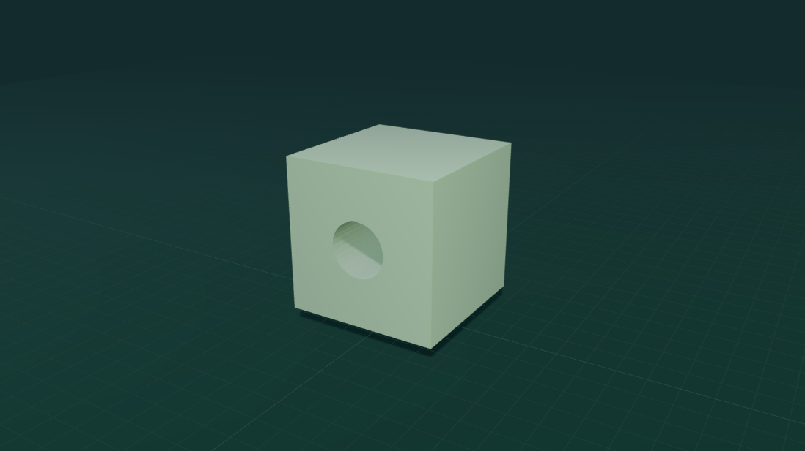

# SignToAST — Spatial Gesture Compiler for Solid Modelling

> Point, pinch, and shape — a local spatial CAD prototype that compiles hand gestures into a typed Abstract Syntax Tree (AST) for solid modelling operations.



## ✨ Features

- **Hand-gesture CAD control** — create, move, scale, and subtract 3D solids using pinch and open-palm gestures via webcam
- **Typed AST compilation** — every committed edit produces a structured `CommandAST` (Create, Move, Scale, Subtract)
- **Real Boolean geometry** — solid subtraction powered by [Manifold](https://github.com/elalish/manifold) WASM
- **Dual input** — full mouse & keyboard support alongside gesture control
- **Fully offline** — runs entirely on localhost with no cloud services, accounts, or remote inference
- **Project persistence** — autosaves to IndexedDB with JSON export/import

## 🛠️ Tech Stack

| Layer | Technology |
| --- | --- |
| Hand tracking | [MediaPipe Tasks Vision](https://developers.google.com/mediapipe) (local WASM inference) |
| Geometry engine | [Manifold 3D](https://github.com/elalish/manifold) (CSG Boolean ops via WASM) |
| 3D rendering | [Three.js](https://threejs.org/) |
| Build tooling | [Vite](https://vite.dev/) + TypeScript |
| Testing | [Vitest](https://vitest.dev/) |
| Package manager | [pnpm](https://pnpm.io/) |

## 🚀 Quick Start

### Prerequisites

- **Node.js** 20.19+ or 22.12+ — [download](https://nodejs.org/)
- **pnpm** — install via `npm install -g pnpm` or `corepack enable`
- **Chrome or Edge** (current version)
- **Webcam** (optional — needed only for gesture control)

### Run from Source

```bash
# 1. Install dependencies
pnpm install --frozen-lockfile

# 2. Download hand model & bundle tracking assets
pnpm assets

# 3. Run tests
pnpm test

# 4. Build for production
pnpm build

# 5. Start the production server
pnpm start
```

Open **http://127.0.0.1:4173** in your browser.

### Development Mode

```bash
pnpm install --frozen-lockfile
pnpm assets            # only needed once (or after changing tracking code)
pnpm dev               # starts Vite dev server with hot reload at :5173
```

### Run the Portable Windows Release

1. Extract the entire `SignToAST` release folder (keep `dist/`, `scripts/`, and `runtime/` beside `start-demo.cmd`)
2. Double-click **`start-demo.cmd`** — keep its console window open
3. Open **http://127.0.0.1:4173** in Chrome or Edge

> [!NOTE]
> The packaged release includes a Node runtime. It does not install packages, contact a CDN, or download a model when launched. Opening `index.html` directly via `file://` will **not** work due to browser worker and camera permission restrictions.

## 📁 Project Structure

```
SignToAST/
├── src/
│   ├── main.ts                  # App entry — input routing, wiring, autosave
│   ├── metrics.ts               # Performance timing and diagnostics
│   ├── recording.ts             # Demo video/snapshot capture
│   ├── storage.ts               # IndexedDB persistence
│   ├── core/
│   │   ├── controller.ts        # Scene state, drafts, Commit/Cancel/Undo
│   │   ├── presentation.ts      # Presentation layer
│   │   ├── recovery.ts          # Error recovery
│   │   └── validation.ts        # AST & scene validation
│   ├── geometry/
│   │   ├── GeometryClient.ts    # Geometry worker client
│   │   ├── kernel.ts            # Manifold WASM kernel wrapper
│   │   └── worker.ts            # Geometry web worker
│   ├── tracking/
│   │   ├── activation.ts        # Toolbar gesture activation
│   │   ├── calibration.ts       # Hand calibration
│   │   ├── client.ts            # Tracking worker client
│   │   ├── gestures.ts          # Temporal gesture rules
│   │   ├── manipulation.ts      # Move/Scale gesture handling
│   │   └── worker.ts            # MediaPipe tracking web worker
│   ├── ui/
│   │   ├── feedback.ts          # Visual action feedback
│   │   ├── viewport.ts          # Three.js viewport & picking
│   │   ├── workspace.ts         # DOM workspace & controls
│   │   └── *.css                # Styles
│   ├── shared/
│   │   └── types.ts             # Shared type definitions
│   └── integration/
│       └── demo.test.ts         # Integration tests
├── scripts/
│   ├── prepare-assets.mjs       # Bundle tracking worker & download model
│   ├── serve.mjs                # Production static server
│   ├── verify-assets.mjs        # SHA-256 asset verification
│   └── package.mjs              # Offline release packager
├── public/                      # Static assets (generated by `pnpm assets`)
├── docs/                        # Architecture, demo guide, validation, roadmap
├── examples/                    # Example project & AST command JSON
├── qa/                          # Dev-only UI test page (not in production)
├── index.html                   # App shell
├── vite.config.ts               # Vite configuration
├── vitest.config.ts             # Test configuration
├── tsconfig.json                # TypeScript configuration
└── package.json                 # Scripts & dependencies
```

## 🎮 Controls

Every edit is a **preview** until you **Commit**. Releasing a pinch freezes the preview — it never auto-commits.

| Action | Gesture | Mouse / Keyboard |
| --- | --- | --- |
| Box | Choose Box | **B** |
| Cylinder | Choose Cylinder | **C** |
| Select | Pinch over a solid or scene list entry | Click solid/list entry; **V** |
| Move | Choose Move → pinch and drag | **M** → drag |
| Scale | Choose Scale → pinch both hands → change separation | **S** → scroll wheel or **+** / **−** |
| Subtract | Select target → choose Subtract → select cutter | **D** → click cutter |
| Commit | Open other hand → hover Commit → fresh pinch | **Enter** |
| Cancel draft | Open other hand → hover Cancel → fresh pinch | **Escape** |
| Undo | Choose Undo | **Ctrl+Z** |
| Pause / Resume | Choose Pause / Resume | **Space** |
| Reset scene | Two activations within 3 seconds | Two clicks on Reset |

> [!TIP]
> Scale is clamped to **0.5–2.0×**. Move snaps to **1 mm** on the object's XY plane. Default box: 20 × 20 × 20 mm. Default cylinder: radius 5 mm, height 60 mm along Z.

## 📷 Calibration & Camera Setup

1. Use a **fixed frontal camera** with good diffuse lighting
2. Keep **both hands fully visible** in frame
3. Select your **pointer hand** (Right or Left) — the preview is mirrored
4. Sweep your pointer hand over a comfortable area, perform **3 pinch/release cycles**, then open your other hand to arm the toolbar

> [!IMPORTANT]
> Calibration is saved to browser local storage. Recalibrating cancels any unfinished draft. If tracking is lost, show both hands, release pinches, and wait for stable tracking.

### Tuning Gesture Controls

Start with: **Pinch sensitivity → Easier**, **Button activation → Pinch**, **Hover stability → Relaxed (350 ms)**. Use the **Test click** button to verify 3 successful clicks before editing.

For demo fallback, choose **Dwell assist** — hold over a button for 0.9s (1.2s for Commit) without needing a pinch.

## 💾 Save & Export

- **Export project** — downloads versioned JSON with solid recipes, transforms, and AST history
- **Autosave** — committed scene is saved to IndexedDB automatically
- **Record demo** — captures CAD canvas + AST as a local WebM video (no webcam/audio)
- **Snapshot** — saves a PNG of the current CAD view
- **Diagnostics export** — timing samples, camera/tracking counters, and backend info

> [!NOTE]
> Raw camera video is never recorded or uploaded. Camera access starts only when enabled. All inference runs locally.

## 🧪 Testing

```bash
pnpm test              # run all tests once
```

Tests cover the controller, gesture rules, geometry kernel, calibration, viewport, activation, manipulation, UI feedback, and end-to-end integration.

## 📦 Packaging an Offline Release

```bash
pnpm build
pnpm package
```

Creates `release/SignToAST` (production build + Node runtime + launcher) and `release/SignToAST-Source` (source code + lockfile + model assets).

## 🔧 Troubleshooting

| Symptom | Recovery |
| --- | --- |
| Local assets unavailable | Run `pnpm assets` and rebuild |
| Camera permission denied | Allow camera in browser settings → re-enable |
| Camera already in use | Close other camera apps and retry |
| Tracking is slow | Improve lighting; close GPU-heavy apps |
| Cursor can't reach controls | Recalibrate with a wider sweep |
| Tool won't activate | Keep other hand open; hover first; release then pinch |
| Subtraction returns empty solid | Move/scale the cutter so target material remains |
| Geometry times out | Previous scene preserved; retry after worker restarts |
| Port 4173 in use | Close the other instance or set `SIGNTOAST_PORT=<port>` |

## 📖 Documentation

- [Architecture & Interfaces](docs/ARCHITECTURE.md)
- [Demo Guide & Presenter Script](docs/DEMO_GUIDE.md)
- [Validation Status](docs/VALIDATION.md)
- [ST-GCN + CTC Roadmap](docs/ROADMAP.md)
- [Example Project](examples/through-hole-project.json) & [Example AST Command](examples/subtract-command.json)
- [Third-Party Notices](THIRD_PARTY_NOTICES.md)

## 📄 License

See [THIRD_PARTY_NOTICES.md](THIRD_PARTY_NOTICES.md) for third-party component licenses (MediaPipe: Apache-2.0, Manifold: Apache-2.0, Three.js: MIT).
