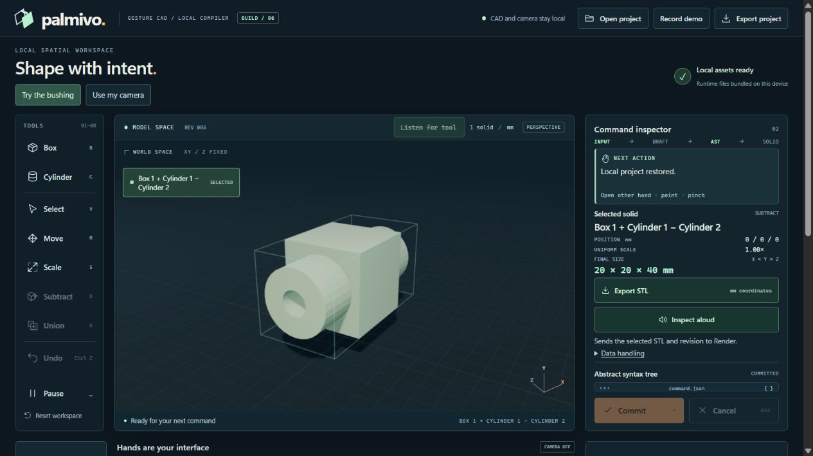

# Palmivo

Palmivo is a browser-based spatial CAD workbench. Use webcam gestures, a mouse, or a keyboard to create and edit solids. A typed command compiler turns each committed operation into Manifold geometry you can reopen as a Palmivo project or export as STL.

[Open Palmivo](https://palmivo.onrender.com/) · [Controls and modelling](docs/DEMO_GUIDE.md) · [Model setup](docs/MODELS.md) · [Render deployment](docs/INSPECT_ALOUD.md)



*Palmivo’s hosted workbench showing the 20 × 20 × 40 mm guide bushing, STL export, and Inspect aloud.*

## Capabilities

| Area | Features |
| --- | --- |
| Input | Two-hand pinch and drag, two-hand scaling, dwell assist, one-hand dwell, pointer and keyboard controls, and local calibration |
| Gesture shortcuts | MediaPipe and temporal rules drive the palette. **Listen for tool** arms pretrained MIT Online TSM shortcuts for Box, Cylinder, and Union. |
| CAD | Boxes and cylinders, exact size presets, 1 mm XY steps, 0.1× scale steps, Boolean Union and Subtract, and final mesh dimensions |
| Commands | Typed AST inspection, reversible previews, explicit Commit and Cancel, Pause, and Undo |
| Projects | IndexedDB autosave, versioned editable JSON, binary STL in millimetres, viewport screenshots, and local CAD recordings |
| Inspect aloud | A Render Workflow checks the exported STL and ElevenLabs speaks the findings. The inspector shows the caption and run ID and offers replay and mute. |

## Run Palmivo

### Hosted app

Open [palmivo.onrender.com](https://palmivo.onrender.com/) in a WebGL2 browser. Choose **Try the bushing** to start without camera setup, or **Use my camera** to calibrate gesture controls. The example is **20 × 20 × 40 mm**. Choose **Scale → +0.1× → Commit** to produce **22 × 22 × 44 mm**.

### Local development

Use Node.js **24.22.1** and pnpm **12.21.0** to match the hosted build. Install dependencies once, prepare the browser assets, and start Vite.

```sh
pnpm install --frozen-lockfile
pnpm run assets
pnpm dev
```

Open `http://127.0.0.1:5173`. For the local production server, run:

```sh
pnpm run build:hosted
pnpm start
```

Open `http://127.0.0.1:4173`. The build serves all model and WASM files locally. `pnpm run build:hosted` checks the pinned MIT TSM export and bushing example. For a local preview of the hosted server, run `node server/host.mjs` and open `http://127.0.0.1:10000`.

### Portable Windows release

Extract `Palmivo-Hybrid-Windows.zip` and run `start-demo.cmd`. The packaged runtime and assets serve the app at `http://127.0.0.1:4181`. Camera tracking, TSM inference, CAD, and project exports work offline. Live **Inspect aloud** uses the hosted service.

To create the portable and source archives, run these commands in PowerShell after installing the project dependencies:

```powershell
pnpm run build:hosted
node scripts/package.mjs --candidate
& .\scripts\archive.ps1 -Candidate
```

The ZIP files and SHA-256 checksums are written to `release/`. [Packaging guide](scripts/README.md)

## Model setup

The checkout includes `public/tracking/hand_landmarker.task` for MediaPipe and `public/tsm/mit-tsm-jester-streaming.onnx` for MIT Online TSM. `pnpm run assets` stages the workers, WASM, and manifests. The pretrained TSM uses a MobileNetV2 backbone, Jester weights, and an FP32 ONNX export. It runs in a dedicated ONNX Runtime Web worker on the device.

| Gesture in the mirrored preview | Draft opened |
| --- | --- |
| Swipe left | Box |
| Swipe right | Cylinder |
| Thumbs up | Union, when a solid is selected and a second solid is available |

Enable the camera, finish calibration, arm **Listen for tool**, and wait for **Make a shortcut**. Each accepted shortcut opens one draft. Choose operands and **Commit** through the regular controls. The [model guide](docs/MODELS.md) covers setup, file integrity, and the separate ST-GCN and streaming CTC research pipeline.

## Deploy Inspect aloud

The root [Render Blueprint](render.yaml) defines the `palmivo` web service and the `palmivo-inspection` Workflow. It uses the published `codex/inspect-aloud` branch. After a user chooses **Inspect aloud**, the web service sends the selected binary STL and scene revision to `inspect_part`. That flow measures the mesh and sends a short findings caption to ElevenLabs Flash v2.5. The browser receives the result, caption, and audio. Camera frames, landmarks, and project history stay in the browser.

| Service | Dashboard variable | Required value |
| --- | --- | --- |
| `palmivo` | `RENDER_API_KEY` | Key for the deployment workspace with Workflow Read and Run permissions |
| `palmivo-inspection` | `ELEVENLABS_API_KEY` | Text to Speech API key |
| `palmivo-inspection` | `ELEVENLABS_VOICE_ID` | ID of an English voice available to the account |

Render supplies the workflow slug and generates the session signing secret. Enter secrets directly in Render. The [deployment guide](docs/INSPECT_ALOUD.md) covers Blueprint setup, billing, data handling, and end-to-end verification.

## Architecture and performance

MediaPipe landmarks, TSM shortcuts, and pointer or keyboard input use one draft controller. The controller validates each AST before executing `Create`, `Move`, `Scale`, `Union`, or `Subtract` in a Manifold WASM worker. Three.js renders the workspace independently of tracking and inference. [Architecture and data contracts](docs/ARCHITECTURE.md)

A local 640 × 480 webcam sample measured **29.43 camera FPS**, **28.85 tracking FPS**, and **59.82 render FPS** while MIT TSM was listening. The 74 timed predictions yielded the following per-frame results.

| Stage | p50 | p95 |
| --- | ---: | ---: |
| TSM inference | 36.36 ms | 40.06 ms |
| TSM frame round trip | 41.60 ms | 45.81 ms |

These timings cover model processing and frame transport. The app measures camera, render, gesture processing, and hosted inspection separately. Use **Run 23 s benchmark**, arm **Listen for tool** during the measurement window, and export the result for the camera and laptop being tested. [Benchmark evidence and procedure](docs/benchmarks/README.md)

## Validate a checkout

```sh
pnpm test
pnpm run build:hosted
node --test server/host.test.mjs
python qa/verify_stl.py examples/flanged-guide-bushing-mm.stl --dimensions 20 20 40 --through-hole
```

The STL audit checks the exported file independently of the CAD engine. For the Python Workflow, install `workflow/requirements.txt` in a virtual environment and run `python -m unittest workflow.test_inspection`. [Developer QA](qa/README.md) · [Hosted verification](docs/INSPECT_ALOUD.md#verify-the-hosted-workbench)

## Repository layout

| Path | Contents |
| --- | --- |
| `src/` | Browser UI, CAD controller, geometry worker, tracking, and TSM runtime |
| `public/` | Pinned model files and generated browser assets |
| `server/` | Hosted HTTP server and Render Workflow gateway |
| `workflow/` | Mesh inspection, ElevenLabs speech generation, and Python tests |
| `ml/` | Optional ST-GCN and streaming CTC capture, training, and evaluation tools |
| `scripts/` | Asset preparation, build checks, serving, and packaging |
| `examples/` and `qa/` | Editable projects, verified STL samples, and developer checks |
| `docs/` | Operating guides, architecture, and benchmark evidence |

`dist/` and `release/` are generated locally. See [documentation](docs/README.md) and [third-party notices](THIRD_PARTY_NOTICES.md).
