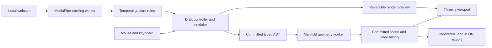

# Architecture

SignToAST separates sensing, interaction, command compilation, and geometry execution. Gesture hypotheses do not directly mutate CAD meshes.

## Module responsibilities

| Module | Responsibility |
| --- | --- |
| `src/main.ts` | Input routing, calibration, worker wiring, autosave, diagnostics |
| `src/tracking` | Camera scheduling, MediaPipe worker, hand features, temporal recognition |
| `src/core/controller.ts` | Authoritative scene state, drafts, Commit, Cancel, Undo |
| `src/core/validation.ts` | AST, scene, bounds, reference, and revision validation |
| `src/geometry` | Manifold WASM kernel, worker transport, timeout/restart |
| `src/ui` | DOM workspace, Three.js scene, picking and plane projection |
| `src/storage.ts` | Local project persistence |
| `src/metrics.ts` | Bounded timing samples and JSON downloads |
| `src/shared/types.ts` | Shared data contracts |

## Threading and backpressure

The main thread renders independently and owns the interaction state. The tracking worker processes one transferred frame at a time. New frames are skipped while it is busy; there is no growing inference backlog. The geometry worker handles committed solid generation and Boolean work.

Tracking initializes its model once. Geometry initializes its WASM module once. Transferred image bitmaps are closed after processing. Geometry results contain independent typed arrays, so deleting Manifold handles cannot invalidate the rendered mesh.

The geometry client assigns increasing job IDs. A three-second timeout terminates the worker and rejects pending work. Old worker responses are ignored after restart. The controller also uses a generation guard, preventing an in-flight result from restoring geometry after a reset.

## Commands and scene data

`CommandAST` is a discriminated union of `Create`, `Move`, `Scale`, and `Subtract`. A command request also contains a unique command ID, base scene revision, and input source. Object references are concrete IDs before execution.

Validation rejects incomplete arguments, nonfinite positions/scales, unsupported bounds, missing objects, identical subtraction operands, duplicate command IDs, and stale scene revisions. The controller permits one draft and one commit transaction at a time.

Selection, pause, Commit, Cancel, and Undo are controller events, not geometry AST variants. The rule recognizer can later be replaced without rewriting the AST executor.

`SceneDocument` version 1 contains:

- `schemaVersion: 1`, `units: "mm"`, and a scene revision.
- Visible solids with IDs, names, colors, positions, uniform scales, and geometry recipes.
- The committed command log for the current scene lineage.

Recipes are centered boxes, Z-axis cylinders, or subtraction trees capturing both source solids. Subtraction applies each source's scale and position before evaluating the Boolean. The resulting solid has its own identity transform; its recipe preserves operand geometry and transforms.

## Preview, Commit, Cancel, and Undo

A draft lives separately from the committed document. Move and Scale previews change render transforms without rebuilding geometry every frame. Commit first validates a typed AST, then waits for required geometry. Success swaps the scene atomically; failure preserves the old scene and leaves the draft available for correction.

Subtraction removes the two operands from the visible scene only after success. Undo restores a previous scene snapshot containing them. Twenty snapshots are retained in memory. Undo advances the revision while restoring the prior geometry state. Reload restores the saved scene and command history, but not the session's Undo stack.

## Coordinate spaces

Camera coordinates, hand-local features, screen coordinates, and CAD coordinates are distinct. Cursor mapping handles the mirrored camera once. Pinch is normalized by palm size. Move uses ray intersection with an explicit plane at the object's current Z; it does not treat inferred hand depth as measured CAD depth.

CAD units are illustrative millimetres. Box defaults are 20 mm per axis. Cylinder defaults are radius 5 mm and height 60 mm along Z. Uniform scale is clamped to 0.5–2.0 and XY translation is snapped to 1 mm.

## Offline deployment

`pnpm assets` emits a locally bundled tracking worker, copies the matching MediaPipe WASM files, and prepares the local `.task` model. It writes a SHA-256 manifest. Startup checks the manifest and initializes the geometry engine before marking local assets ready.

Vite emits local application and geometry-worker assets. The static server binds to `127.0.0.1:4173`; it serves production files with JavaScript/WASM MIME types, local camera permission policy, and cross-origin isolation headers. No service worker, remote inference server, login, or cloud storage is required.

## Measurement boundaries

Camera delivery FPS and processed tracking FPS are separate. Inference timings cover the tracking call; rules-to-draft timing covers recognition and synchronous interaction handling; geometry timings cover the asynchronous geometry request. Render-frame intervals and command completion times are separate samples.

The collector keeps a bounded rolling sample window per metric. Its export includes p50, p95, and sample counts. These values do not establish physical motion-to-display latency. No trained ST-GCN/CTC inference is included in the current timing path.

